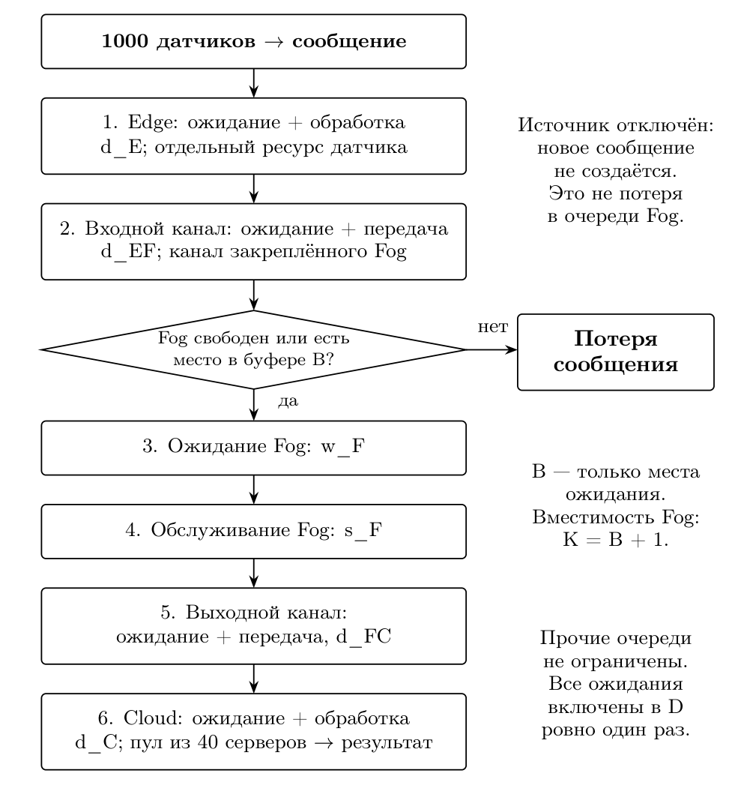
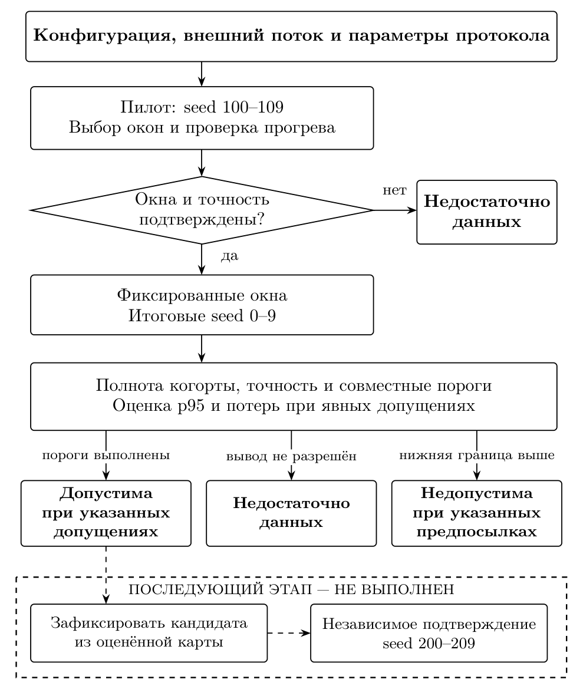
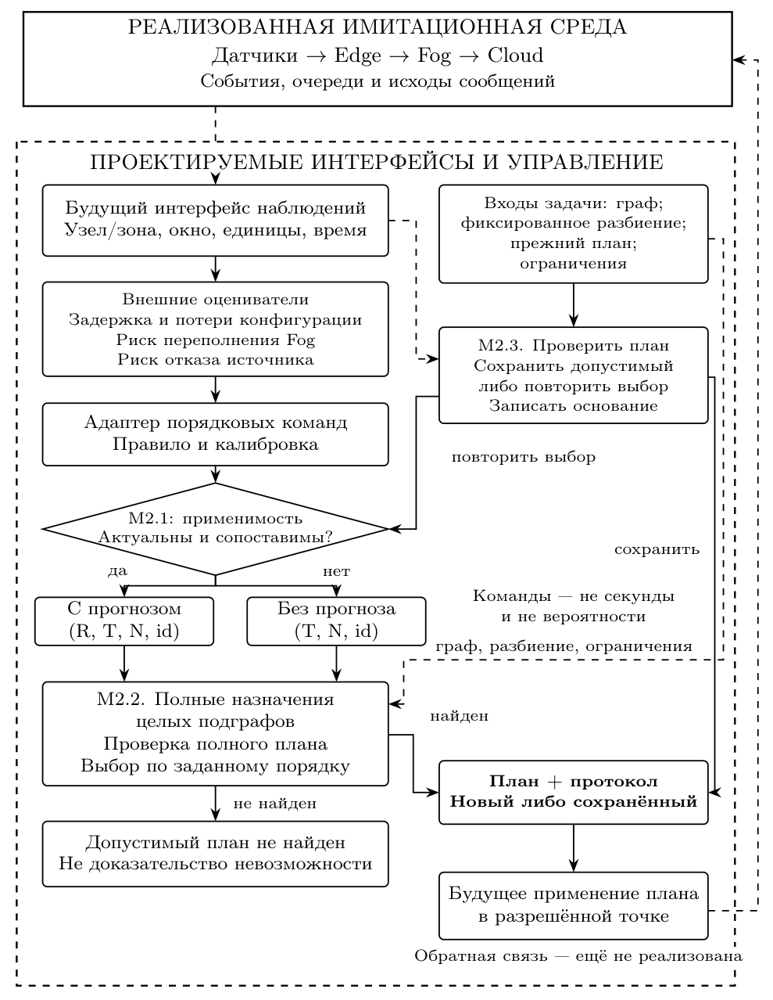

**Моделирование краевой и туманной среды для выбора конфигурации и переразмещения связных задач с учётом прогноза**

**Орда-Жигулина Марина Владимировна; Орда-Жигулина Дина Владимировна; Игнатенко Александр Сергеевич**

Федеральное государственное бюджетное учреждение науки «Федеральный исследовательский центр Южный научный центр Российской академии наук».

344006, Россия, Ростов-на-Дону, пр. Чехова, 41.

**Контактный автор:** М. В. Орда-Жигулина, jigulina@mail.ru.

УДК 004.942

**Аннотация.** Представлена дискретно-событийная модель краевой и туманной среды с облачным уровнем обработки. Она используется для совместной проверки требований к хвосту задержки и потерям сообщений. Протокол разделяет пилотные и итоговые реализации, учитывает всю когорту поступлений и сохраняет исходные данные. Исследована одна синтетическая конфигурация: 1000 датчиков, 30 туманных узлов, пять мест ожидания на узел и 40 облачных серверов. При опорной нагрузке $\rho_{50}=0{,}10$ десять итоговых реализаций содержат 1 999 801 завершённое сообщение без наблюдённых потерь. Оценка 95-го перцентиля задержки равна 170,9 мс; номинальный 95%-й доверительный интервал составляет [170,6; 171,0] мс. При допущении независимых исходов с общей вероятностью потери верхняя условная оценка потерь равна 0,00185%. Она получена по наименьшей когорте из 199 114 поступлений. Конфигурация удовлетворяет совместным порогам 200 мс и 0,1% при указанном допущении; минимальность не установлена. Аналитический ориентир p95 обслуживания без ожидания составляет 151,0 мс. Описана архитектура будущего переразмещения целых подграфов с внешним прогнозным модулем и независимой проверкой полного плана. Прогнозное управление в итоговой серии не выполнялось.

**Ключевые слова:** краевые вычисления; туманные вычисления; дискретно-событийное моделирование; хвост задержки; потери сообщений; конечный буфер; связная задача.

# 1. Введение

Как проверить заданную вычислительную конфигурацию по задержкам и потерям, не подменяя наблюдаемый результат гарантией надёжности? Этот вопрос возникает при ограниченных ресурсах и конечных буферах. Большой буфер может уменьшить потери при переполнении, но одновременно увеличить ожидание принятых сообщений. Поэтому оба требования необходимо проверять совместно.

Краевые вычисления (edge computing) приближают обработку к источнику данных. Туманные вычисления (fog computing) добавляют промежуточный уровень распределённых ресурсов [1, 2]. В рассматриваемой среде облачный уровень (cloud computing) завершает обработку сообщений. Оценка средней задержки недостаточна: она не описывает длительные ответы, формирующие хвост распределения.

Цель исследования — разработать проверяемую модель краевой и туманной среды, оценить одну синтетическую конфигурацию по задержкам и потерям и определить архитектуру будущего прогнозного переразмещения связных задач.

Работа объединяет событийный расчёт, учёт полной когорты поступлений и правило совместной проверки требований. Полученный статус сопровождается статистическими предпосылками и ссылкой на исходные наблюдения. Недостаточность данных является самостоятельным исходом. Отличие предлагаемой организации проверки состоит в разделении этих оснований, а не в доказанном превосходстве над универсальными симуляторами.

Численный результат относится к потоку сообщений при неизменной конфигурации. Размещение целых подграфов связной задачи рассматривается отдельно как направление развития. Такой порядок позволяет использовать созданную среду для последующей проверки управления, не приписывая ей ещё не выполненные функции.

Вклад статьи включает четыре результата:

1. Определены общие входные потоки, измерительная когорта и согласованный расчёт шести составляющих задержки.
2. Задан протокол совместной оценки задержки и потерь с раздельными группами реализаций и исходом недостаточности данных.
3. Представлены итоговая серия для одной конфигурации и аналитический ориентир без ожидания; наблюдаемые показатели отделены от условного статистического вывода.
4. Описана архитектура будущего переразмещения целых подграфов, в которой прогнозное предпочтение не заменяет проверку полного плана.

# 2. Обзор родственных работ

## 2.1. Средства моделирования

iFogSim моделирует управление ресурсами в средах интернета вещей, Edge и Fog [3]. iFogSim2 расширяет этот подход моделями мобильности, кластеризации и микросервисов [4]. EdgeCloudSim ориентирован на оценку производительности краевых систем [5], а YAFS — на сценарии интернета вещей в туманных средах [6].

Современные инструменты уточняют разные стороны таких сред. EdgeSimPy моделирует управление ресурсами и жизненный цикл приложений [7]. ENIGMA поддерживает масштабируемое моделирование и мобильность устройств [8]. VonEdgeSim рассматривает добровольно предоставляемые краевые ресурсы [9]. Эти возможности определяют область применения инструмента, но не делают результаты разных сценариев сопоставимыми автоматически.

MintEDGE исследует энергопотребление, размещение и сетевые характеристики [10]. EdgeAISim включает модели управления ресурсами с использованием искусственного интеллекта [11]. MECSim рассматривает неоднородные ресурсы, зависимые задачи и надёжность [12]. Сравнительное исследование [13] выделяет качество программ, состояние сопровождения и возможности моделирования.

В настоящей работе принят более узкий предмет: проверка заданной конфигурации по двум требованиям при явном учёте поступлений. Сохраняется связь между исходной когортой, оценкой и выводом. Скорость и точность перечисленных симуляторов между собой здесь не сравниваются.

## 2.2. Очереди и статистический анализ

Обозначения теории очередей различают распределение поступлений, обслуживание и вместимость системы [14]. Соотношение Литтла связывает средние показатели, но не определяет хвост задержки [15]. Поэтому средняя загрузка служит характеристикой сценария, а не заменой p95.

Анализ выходных данных, сравнение конфигураций и уменьшение дисперсии рассматриваются в главах 9–11 книги Law [16]. Верификация программы и проверка соответствия модели реальной системе решают разные задачи [17]. Ручной контроль ниже проверяет событийную реализацию; он не подтверждает аппаратное происхождение синтетических профилей.

Bootstrap оценивает неопределённость посредством повторных выборок [18]. Для выходных показателей имитации результат зависит от распределения и оцениваемого параметра [19]. В данной работе пересэмплируются целые реализации, чтобы не разрушать внутригрупповую зависимость. Номинальное доверительное покрытие при этом не объявляется доказанным для произвольной зависимости.

## 2.3. Размещение и прогнозные подсказки

Обзор Brogi и соавторов систематизирует ограничения размещения приложений в туманных средах [20]. HEFT назначает задачи неоднородным процессорам по правилу раннего завершения [21]. В проектируемом расширении нашей среды единицей назначения служит целый подграф; проверяется полный план связной задачи.

Работы о кэшировании с обучаемыми подсказками исследуют соотношение качества прогноза и устойчивости алгоритма [22–24]. Для нашего расширения существенна идея разделения подсказки и обязательных требований. Теоретические гарантии этих работ не переносятся на рассматриваемую среду.

Конформное предсказание связывает прогнозный интервал с условиями калибровки [25]. Нарушение обменности данных требует отдельного анализа [26]. Эти источники определяют требования к будущему прогнозному модулю, но не удостоверяют обучение или калибровку в выполненной серии.

# 3. Модель вычислительной среды

## 3.1. Путь сообщения, ресурсы и исходные параметры

Объект численного опыта — созданное датчиком сообщение, которое проходит последовательную обработку. Оно не тождественно связной задаче из раздела 6. Для каждого сообщения учитываются источник, время поступления, потенциальные длительности и конечный исход: завершение, потеря либо незавершённость к моменту наблюдения.

Датчик сначала использует собственный ресурс Edge. Затем сообщение проходит входной канал своего Fog, ожидает обработки на Fog и поступает в выходной канал. Обработку завершает общий пул Cloud. На рисунке 1 показаны путь сообщения и единственное место потери из-за ограниченной вместимости.

{width=14.5cm}

**Рисунок 1. Реализованная среда: ресурсы, шесть составляющих задержки и потеря при заполнении Fog.**

*Implemented environment: resources, six latency components, and loss at a full fog queue.*

Очереди обслуживаются в порядке поступления без прерывания. Буфер $B$ задаёт число мест ожидания перед каждым Fog; обслуживаемое сообщение в него не входит. Вместимость Fog вместе с занятым ресурсом равна $K=B+1$. Если ресурс занят и все места ожидания заполнены, новое сообщение теряется при входе Fog.

Остальные очереди в модели не ограничены. Их ожидания входят в задержку, но не создают отдельного механизма потери. Отсутствие сообщения от отключённого датчика отличается от потери уже созданного сообщения. Большая задержка также не означает потерю: незавершённые сообщения учитываются отдельно.

Внешние поступления образуют пуассоновский поток интенсивности $\lambda$, измеряемой в сообщениях в секунду. Источник каждого сообщения выбирается равномерно из 1000 датчиков. Тип датчика фиксируется внутри реализации. Параметры таблицы 1 задают синтетический сценарий, а не результаты измерений оборудования.

**Таблица 1. Параметры синтетической среды и их происхождение.**

*Synthetic environment parameters and their provenance.*

| Параметр | Значение | Основание |
|:--|:--|:--|
| Датчики и ресурсы Edge | 1000 | Предшествующий авторский сценарий |
| Совместное обслуживание Edge и входного канала | $U(5,15)$ мс для стационарного; $U(8,20)$ мс для мобильного датчика | Диапазоны — авторский материал; равномерный закон — допущение |
| Обслуживание Fog | $U(30,80)$ мс | Диапазон — авторский материал; равномерный закон — допущение |
| Обслуживание Cloud | $U(10,30)$ мс | Диапазон — авторский материал; равномерный закон — допущение |
| Выходная передача Fog–Cloud | $U(20,50)$ мс | Допущение |
| Вероятность мобильного типа | 0,30 | Допущение; тип фиксируется в реализации |
| Доля обработки Edge | 0,50 совместного времени Edge и входного канала без ожидания | Допущение |
| Серверы общего пула Cloud | 40 | Допущение |

Здесь $U(a,b)$ — равномерное распределение на интервале от $a$ до $b$. Диапазоны обслуживания и число датчиков взяты из ранее подготовленного авторского материала НСКФ-2026. Равномерный закон и остальные допущения относятся к настоящей модели.

[ДЛЯ АВТОРА A03: согласовать ссылку на предшествующий материал — источник диапазонов; номер и полные реквизиты будут заполнены в сопроводительном письме. Диапазоны не являются новыми аппаратными измерениями.]

Один случайный интервал делится поровну между обработкой Edge и входной передачей. Эти две части зависимы; считать их независимыми при расчёте суммарного обслуживания нельзя. Остальные потенциальные длительности независимы при заданном типе датчика. Ожидания ресурсов добавляются отдельно.

Число Fog обозначим через $n_F$. Датчик с идентификатором $i$ закреплён за узлом $i\bmod n_F$. Поэтому узлы могут обслуживать неодинаковое число источников. Вместе с числом Fog изменяется число соответствующих каналов; это изменение конфигурации, а не только вычислительной мощности.

Входные времена, источники и потенциальные длительности генерируются до сравнения конфигураций. Они сохраняются и для сообщений, которые затем теряются. Такой порядок позволяет использовать одинаковые входы без сдвига случайной последовательности из-за разных потерь.

Календарь событий использует целые тики длительностью 1 нс. При совпадении времён освобождение ресурса обрабатывается раньше нового поступления; далее действует стабильный порядок идентификаторов. Это правило разрешает одновременность в модели, но не характеризует точность физических часов.

## 3.2. Измерительная когорта и шесть составляющих задержки

Измерительная когорта включает все внешние сообщения, поступившие в выбранном окне. Обозначим число поступлений через $A$, завершений — через $C$, потерь — через $N_L$, незавершённых сообщений — через $N_U$. Для каждого снимка проверяется баланс $A=C+N_L+N_U$.

Пусть $D_i$ — задержка завершённого сообщения от внешнего поступления до окончания Cloud. Доля потерь $L$, 95-й перцентиль $Q$ и доля своевременных завершений $H(t)$ определяются по формулам

$$
L=\frac{N_L}{A},\qquad Q=p95\{D_i\}_{i=1}^{C},\qquad
H(t)=\frac{\#\{i:D_i\leq t\}}{A}.\qquad(1)
$$

В формуле (1) p95 вычисляется только по завершённым сообщениям. В знаменателе $H(t)$ остаются все поступления, включая потери и незавершённые сообщения. Время $t$ отсчитывается от поступления каждого сообщения. При пустой когорте оценки отсутствуют, а не равны нулю.

Сквозная задержка завершённого сообщения складывается из шести составляющих:

$$
D_i=d_{E,i}+d_{EF,i}+w_{F,i}+s_{F,i}+d_{FC,i}+d_{C,i}.\qquad(2)
$$

Величина $d_E$ включает ожидание и обработку Edge; $d_{EF}$ — ожидание и входную передачу. Ожидание и обслуживание Fog обозначены отдельно: $w_F$ и $s_F$. В $d_{FC}$ входят ожидание и выходная передача, а в $d_C$ — ожидание и обработка Cloud. Каждое ожидание учитывается в формуле (2) один раз.

## 3.3. Нагрузка и аналитический ориентир

Опорная предложенная нагрузка $\rho_{50}$ относится к среде с 50 Fog. Среднее обслуживание Fog равно 0,055 с. Внешняя интенсивность и средняя предложенная нагрузка конфигурации задаются соотношениями

$$
\lambda=\frac{50\rho_{50}}{0{,}055},\qquad
\overline{\rho}_F=\frac{\lambda\,0{,}055}{n_F}.\qquad(3)
$$

К зоне узла $j$ направляется внешний поток интенсивности $\lambda_j=\lambda m_j/1000$, где $m_j$ — число закреплённых датчиков. Эти величины не являются измеренной занятостью. После Edge и входного канала поступления непосредственно в Fog не обязаны оставаться пуассоновскими. При сравнении конфигураций внешняя интенсивность $\lambda$ должна сохраняться.

Для отделения обслуживания от ожидания рассмотрим суммарное обслуживание $S_z$ при типе датчика $z$. Оно содержит четыре независимых примитива $X_{k,z}\sim U(a_{k,z},a_{k,z}+w_{k,z})$, $k=1,\ldots,4$. Edge вместе с входной передачей составляет один примитив. При $a_z=\sum_k a_{k,z}$ функция распределения имеет вид

$$
F_z(x)=\frac{\displaystyle\sum_{J\subseteq\{1,2,3,4\}}(-1)^{|J|}
\left(x-a_z-\sum_{j\in J}w_{j,z}\right)_+^4}
{24\displaystyle\prod_{k=1}^{4}w_{k,z}}.\qquad(4)
$$

Здесь $(u)_+=\max(u,0)$. Формула (4) получается интегрированием равномерной плотности на прямоугольнике, отсечённом условием на сумму. Аналитический профиль использует смесь $F=0{,}70F_{\mathrm{стац}}+0{,}30F_{\mathrm{моб}}$. Её веса заданы моделью; фактическая доля типов внутри реализации может отличаться.

Решение $F(x)=0{,}95$ даёт 151,0 мс. Среднее обслуживание равно 121,2 мс, максимальное — 180 мс. Это ориентир до отбора завершённых сообщений, без ожиданий. При потерях состав завершённой выборки меняется, поэтому ориентир не объявляется нижней границей её p95. Максимум ниже 200 мс и не обосновывает отсечение конфигураций.

# 4. Метод выбора конфигурации

## 4.1. Подготовка данных и выбор окон

Метод разделяет подготовку окон наблюдения, итоговую оценку и возможное независимое подтверждение. В настоящей работе выполнена итоговая оценка одной конфигурации. Общий порядок сравнения сохранён для будущего расширения эксперимента.

Каталог модели содержит нагрузки $\rho_{50}=0{,}10;\ 0{,}30;\ 0{,}50;\ 0{,}70;\ 0{,}85;\ 0{,}95$ и числа Fog 30, 40, 50, 60, 70. Буфер принимает значения 0, 2, 5, 10, 20, 50, 100, 200, 400. Эти сочетания образуют 270 конфигураций, но не 270 завершённых опытов.

Каждый расчётный запрос задаёт конфигурацию, начальное состояние генератора (seed) и окна наблюдения. Для парного сравнения необходимы одинаковые внешние события и одинаковые горизонты. Совпадение одного seed не обеспечивает этой сопоставимости.

Пилотные реализации используют seed 100–109, итоговые — 0–9, подтверждающие — 200–209. Группы не смешиваются. Пилот определяет окна до начала итоговой серии. Подтверждающие данные разрешено использовать только после фиксации кандидата.

Прогрев $W$, измерительное окно $T_o$ и защитный хвост $G_o$ первоначально равны $2000\cdot50/\lambda$, $4000\cdot50/\lambda$ и $1000\cdot50/\lambda$ секунд. В защитном хвосте внешний поток продолжается. Поэтому завершение когорты наблюдается при действующей нагрузке, а не при искусственном опустошении системы.

Лестница прогрева содержит 2000, 4000, 8000 и 16000 ожидаемых поступлений на опорный Fog. Лестница наблюдения содержит 4000, 8000, 16000 и 32000 поступлений. Сравниваются соседние уровни прогрева и половины измерительного окна.

Интервал разности должен целиком лежать в пределах ±10 мс для $Q$ и ±0,00005 доли для $L$. Эти допуски не увеличивают пороги допустимости. Достижение предела без выполнения проверки даёт «недостаточно данных», а не доказанную нестационарность.

## 4.2. Совместная оценка задержки и потерь

p95 вычисляется по объединённым задержкам десяти итоговых реализаций, а не усреднением их квантилей. Кластерный bootstrap (cluster bootstrap) пересэмплирует целые реализации: 10000 повторов, seed 20261123. Это способ построения интервала по имеющимся данным, а не дополнительные независимые опыты.

Описательные интервалы имеют номинальный уровень 95%, верхние односторонние границы каждой метрики — 97,5%. Обозначим их через $U_Q$ и $U_L$. После проверок прогрева, полноты когорты и точности совместное принятие требует

$$
U_Q\leq200\ \mathrm{мс},\qquad U_L\leq0{,}001.\qquad(5)
$$

При ненулевых потерях используется bootstrap целых реализаций. При нуле потерь все повторные выборки также дают ноль, поэтому интервал [0; 0] не подтверждает малый ненаблюдавшийся риск.

Для этого случая отдельно применяется условная оценка Клоппера–Пирсона [27]. Она предполагает независимые исходы с общей вероятностью потери $p$. Пусть $n_i$ — число поступлений итоговой реализации $i$, а $n_{\min}=\min_i n_i$. При нуле потерь во всех десяти реализациях используется

$$
U_L=1-0{,}025^{1/n_{\min}}.\qquad(6)
$$

Формула (6) следует из равенства $(1-p)^n=0{,}025$ для независимых исходов. Выбор $n_{\min}$ не устанавливает независимость сообщений очереди. Поэтому положительный результат называется «допустима при указанном допущении», а не безусловной гарантией.

При нуле потерь допуск ширины интервала проверяется по $U_L/2\leq0{,}00005$. Эта проверка не измеряет зависимость сообщений или фактическую ошибку оценки. Проверки прогрева, завершённости когорты и точности p95 сохраняются. Решение принимается по неокруглённым значениям.

Если предварительные проверки выполнены, превышение порога нижней границей означает недопустимость по соответствующей метрике. Если интервал не позволяет сделать вывод, сохраняется «недостаточно данных». Неизвестный результат не заменяется положительным или отрицательным.

## 4.3. Кандидат, подтверждение и границы выбора

Для последующего сравнения допустимых конфигураций задан лексикографический порядок $(n_F,B)$: сначала меньшее число Fog, затем меньший буфер. Это порядок предпочтения, а не экономическая модель стоимости. Неисследованные и неопределённые варианты нельзя исключать из обоснования минимальности.

{width=14.5cm}

**Рисунок 2. Протокол проверки: самостоятельный исход недостаточности данных и последующее подтверждение только зафиксированного кандидата.**

*Evaluation protocol: insufficient data is a separate outcome; subsequent confirmation is limited to a frozen candidate.*

Рисунок 2 разделяет три исхода оценки и показывает независимое подтверждение как последующий, не выполненный здесь этап. К нему допускается только заранее зафиксированный кандидат. После неуспешного подтверждения следующий кандидат не выбирается на тех же данных. В настоящей статье минимальная конфигурация и независимое подтверждение не заявляются.

# 5. Результаты

## 5.1. Ручной контроль событий

Для проверки событийного расчёта используется синтетический пример: один Fog, два места ожидания и пять сообщений. Внешние поступления происходят в моменты 0, 1, 2, 3, 10 мс. Обработка Edge, входная передача, обслуживание Fog, выходная передача и Cloud занимают соответственно 1, 1, 10, 1, 1 мс.

В Fog сообщения поступают в моменты 2, 3, 4, 5, 12 мс. Первое занимает ресурс, второе и третье ожидают, четвёртое теряется. Пятое приходит одновременно с освобождением ресурса. Освобождение обрабатывается первым, поэтому пятое сообщение принимается. Результаты по шести составляющим приведены в таблице 2.

**Таблица 2. Ручной контроль: задержки завершённых сообщений, мс.**

*Manual control: delays of completed messages, in milliseconds.*

| Сообщение | $d_E$ | $d_{EF}$ | $w_F$ | $s_F$ | $d_{FC}$ | $d_C$ | $D$ |
|:--|--:|--:|--:|--:|--:|--:|--:|
| 1 | 1 | 1 | 0 | 10 | 1 | 1 | 14 |
| 2 | 1 | 1 | 9 | 10 | 1 | 1 | 23 |
| 3 | 1 | 1 | 18 | 10 | 1 | 1 | 32 |
| 5 | 1 | 1 | 20 | 10 | 1 | 1 | 34 |

Сообщение 4 потеряно при входе Fog; сквозная задержка завершения для него не определяется. Пример проверяет ожидание, переполнение, одновременность событий и сумму формулы (2). Он не является стационарным опытом и не оценивает вероятность отказа датчика.

## 5.2. Итоговая серия одной конфигурации

Итоговая конфигурация содержит 1000 датчиков, 30 Fog, пять мест ожидания перед каждым Fog и 40 серверов Cloud. Внешняя интенсивность равна 90,90909 сообщения/с при $\rho_{50}=0{,}10$. Прогрев и измерительное окно составляют по 2200 с, защитный хвост — 550 с.

По seed 0–9 выполнены десять итоговых реализаций. Завершено 1 999 801 сообщение измерительной когорты; потери и незавершённые сообщения отсутствуют. Таблица 3 разделяет непосредственно наблюдённые показатели и условный статистический вывод.

**Таблица 3. Итоговая серия: $\rho_{50}=0{,}10$, $n_F=30$, $B=5$, десять реализаций.**

*Main series: $\rho_{50}=0.10$, $n_F=30$, $B=5$, ten replications.*

| Показатель | Значение |
|:--|:--|
| Поступления / завершения | 1 999 801 / 1 999 801 |
| Потери / незавершённые | 0 / 0 |
| Средняя задержка | 127,2 мс |
| p95 | 170,9 мс |
| Номинальный 95%-й интервал p95 | [170,6; 171,0] мс |
| Верхняя номинальная граница $U_Q$ | 171,0 мс |
| Наблюдённые потери | 0,000% |
| Условная верхняя оценка $U_L$ | 0,00185% |
| Наименьшая когорта $n_{\min}$ | 199 114 |
| Доля $H(200\ \mathrm{мс})$ | 0,986 |
| Совместный вывод | Допустима при указанном допущении |

Числа поступлений для seed 0–9 равны соответственно 200298, 199701, 200008, 199114, 200298, 200255, 199726, 199959, 200445, 199997. Минимум составляет 199114. Формула (6) использует именно этот минимум, а не сумму, среднее или число завершений.

Сохранённый bootstrap-анализ потерь даёт [0; 0] и статус недостаточности данных. Отдельный условный анализ тех же когорт даёт $U_L=0{,}00185\%$. Эти результаты отвечают разным статистическим предпосылкам и представлены раздельно.

Верхняя граница p95 равна 171,0 мс. При выполненных проверках прогрева, полноты и точности обе верхние оценки ниже совместных порогов. Следовательно, исследованная конфигурация допустима при допущении независимых исходов с общей вероятностью потери. Независимое подтверждение из этого вывода не следует.

## 5.3. Аналитическая сверка и достаточность данных

Приближённая очередь M/M/1/K рассматривается только как ориентир. В ней $K=B+1=6$, средняя интенсивность обслуживания $\mu=1/0{,}055\ \mathrm{с}^{-1}$. При поступлениях $\lambda_j$ непосредственно в узел $j$ и $\rho_j=\lambda_j/\mu$ стационарная доля отказов равна

$$
\pi_{K,j}=\frac{\rho_j^K}{\displaystyle\sum_{k=0}^{K}\rho_j^k}.\qquad(7)
$$

В исследованной конфигурации десять Fog обслуживают по 34 датчика, двадцать — по 33. При $\lambda_j=\lambda m_j/1000$ взвешенная по поступлениям оценка формулы (7) равна 0,00179%. Она ниже порога 0,1%, но не является точной оценкой потерь имитации.

M/M/1/K предполагает экспоненциальное обслуживание и пуассоновские поступления непосредственно в Fog. В нашей модели обслуживание равномерно, а сообщения предварительно проходят Edge и канал. Поэтому совпадение порядка величин не доказывает эквивалентность моделей или независимость потерь.

Пример остановки пилота показывает роль допуска точности. Для $B=0$ сравнение прогрева 8000 и 16000 дало интервал разности потерь [−0,000455; 0,000470]. Он содержит ноль, но выходит за ±0,00005. Следовательно, эквивалентность не подтверждена с заданной точностью; нестационарность этим не доказана.

Фиксированный набор данных содержит 131 расчётный запрос: 121 пилотный и 10 итоговых. Разные окна одного seed образуют разные запросы, но не независимые конфигурации. В исходной карте три клетки имеют статус недостаточности данных, остальные 267 — без итогового статуса. Из этих трёх только одна завершила итоговую серию; её условный анализ приведён выше.

Для чисел таблицы 3 сохранены первичные когорты, идентификаторы реализаций и контрольные суммы. Доверительные интервалы используются из сохранённого расчёта; редакционная сверка не является независимым подтверждением. Одна итоговая точка не задаёт кривую зависимости p95 от буфера. Вклады стадий также нельзя восстанавливать из одного суммарного p95.

# 6. Развитие среды: переразмещение с учётом прогноза

## 6.1. Связная задача и выбор полного плана

Конфигурирование определяет состав среды до исполнения. Переразмещение изменяет назначения частей связной задачи при изменении состояния среды. Ниже описана проектируемая интеграция метода; итоговая серия раздела 5 выполнена без такого управления.

Входами метода служат граф связной задачи, его фиксированное разбиение, прежний план и ограничения ресурсов, связей и срока. Единица назначения — целый подграф. Перенос сохраняет его состав, поэтому внутреннюю вершину нельзя назначить независимо. Переразбиение создаёт новые части и является другой операцией.

М2.1 подготавливает применимые команды: проверяет актуальность, область действия и сопоставимость, затем фиксирует их на время поиска. М2.2 рассматривает полные назначения целых подграфов. Для каждого назначения выполняется проверка полного плана всей связной задачи, включая ресурсы, информационные зависимости, передачи данных и срок.

Пусть $a$ — полный план. Вектор $R(a)$ содержит прогнозные команды для назначений подграфов, упорядоченные по убыванию. Величина $T(a)$ — расчётная длительность всей связной задачи, а $N(a)$ — число переносов относительно прежнего плана. Допустимые планы сравниваются по правилу

$$
\min_{\mathrm{lex}}\bigl(R(a),T(a),N(a),\operatorname{id}(a)\bigr).\qquad(8)
$$

Сначала сравниваются наибольшие команды, затем следующие значения до первого различия. Предпочтителен меньший вектор. При равенстве учитываются $T$, затем $N$ и стабильный идентификатор. Это лексикографическое минимаксное сравнение. Команды задают порядок, но не секунды или вероятности; $T(a)$ не является p95 потока сообщений.

Без применимых команд используется порядок $(T,N,\operatorname{id})$ по текущим данным. Если допустимый план не найден, выдаётся отдельное заключение. При ограниченном поиске оно не доказывает невозможность размещения. Результат успешного выбора — полный план с протоколом проверки, а не рекомендация другому методу.

## 6.2. Внешний прогнозный модуль и адаптер команд

Предусматриваются три внешних оценивателя: задержки и потерь конфигурации, риска переполнения Fog и риска отказа источника. Они не выбирают размещение и не проверяют допустимость полного плана. Для передачи их выходов методу нужен отдельный адаптер порядковых команд.

Входная запись должна указывать устройство или зону, окно наблюдения, единицы и временную метку. Возможные сведения включают очереди, занятость, характеристики подграфов и телеметрию источников. Общие p95, потери и $H(200\ \mathrm{мс})$ характеризуют среду, но не заменяют данные отдельных узлов и стоимость выполнения подграфов.

Для каждого оценивателя задаются целевая переменная, горизонт и область применения. Признаки ограничиваются сведениями, доступными к моменту прогноза. Исходы будущего окна служат целевыми значениями, а не заранее известными признаками. Ручное отключение датчика не заменяет размеченные данные об отказах.

Адаптер должен преобразовывать прогнозные характеристики в сопоставимые порядковые команды по явно заданному правилу. Необходимы калибровка и проверка на отложенных конфигурациях. Без них физическая оценка или риск не становятся командой автоматически. Такая интеграция и обучение оценивателей в текущем опыте не выполнялись.

## 6.3. Обновление решения и применение плана

Рисунок 3 разделяет реализованную среду и проектируемое управление. Сплошная рамка обозначает событийную среду, пунктирная — будущие интерфейсы, оцениватели, выбор и применение плана. Сплошные стрелки внутри проектируемой области задают логическую последовательность, но не означают выполненную интеграцию.

М2.3 получает обновлённое состояние, проверяет возможность сохранения прежнего допустимого плана либо инициирует повторный выбор. Основание решения регистрируется. Ветви неприменимого прогноза и отсутствия найденного плана отделены от успешного выбора; неуспех не подменяется командой миграции.

Применение выбранного плана — самостоятельный будущий этап в разрешённой точке исполнения. До него должны быть учтены актуальность плана и затраты переноса. Проектируемая обратная связь после применения не входит в выполненную имитационную серию.

Перенос на другой узел сам по себе не гарантирует ускорения. Результат зависит от характеристик целого подграфа, занятости узла, передач и стоимости применения плана. Горизонт упреждения задаёт окно подготовки, а не гарантированный резерв времени.

Для будущей проверки потребуются одинаковые входы и раздельные сравнения базового режима, синтетических порядковых команд и обученного оценивателя. Синтетические команды проверяют правило выбора, но не качество нейросетевого прогноза. Обучающая, настроечная и проверочная части должны быть разделены до настройки оценивателя.

{width=14.5cm}

**Рисунок 3. Реализованная среда и проектируемое прогнозное управление. Выбор, сохранение и будущее применение полного плана разделены.**

*Implemented environment and proposed forecast-aware control. Selection, retention, and future application of a complete plan are separated.*

# 7. Обсуждение и ограничения

**Область численного вывода.** Исследована одна синтетическая конфигурация при одной внешней интенсивности. Наблюдённые задержки и отсутствие потерь подтверждены сохранённой серией. Они не устанавливают минимальное число Fog, минимальный буфер, масштабируемость или преимущество над другой средой.

**Статистические предпосылки.** Условный вывод зависит от независимых исходов с общей вероятностью потери. Эти свойства не установлены для выходов очереди. Номинальное покрытие интервалов и гибридного правила их выбора не является гарантией для произвольной зависимости. Десять исходных реализаций не заменяются 10000 повторами bootstrap.

Чувствительность условной оценки можно описать подстановкой предполагаемого эффективного объёма $n_{\mathrm{eff}}$ вместо $n_{\min}$ в формулу (6). Это сценарий, а не измерение зависимости. Достаточное округлённое условие сохранения порога $U_L\leq0{,}001$ имеет вид

$$
n_{\mathrm{eff}}\geq
\left\lceil\frac{-\ln0{,}025}{0{,}001}\right\rceil=3689.\qquad(9)
$$

При $n_{\mathrm{eff}}=3689$ оценка равна приблизительно 0,00099947 доли. Фактический минимум превышает 3689 примерно в 54,0 раза. При сценарном уменьшении объёма в 50 раз оценка составляет 0,0926%: порог потерь сохраняется, но отдельный допуск ширины $U_L/2\leq0{,}00005$ уже нарушается. Поэтому этот сценарий не сохраняет полный критерий допустимости.

**Модельные границы.** Равномерные профили и принятая маршрутизация не заменяют измерения реального оборудования. Внешние изменения, пакетная передача, физические отказы и стоимость миграции в итоговой серии не моделировались. Увеличение числа Fog изменяет также число каналов; эффект нельзя приписывать только процессорам.

**Границы сравнения.** Каталог из 270 конфигураций шире завершённого опыта. Ресурсная остановка оставляет клетки неизвестными, а не недопустимыми. Одновременное покрытие всей карты и независимое подтверждение не установлены. Для сравнения нескольких конфигураций нужны заранее заданные варианты и сопоставимые окна.

**Границы ориентиров и развития.** p95 обслуживания без ожидания не объявляется нижней границей условного p95 завершённых сообщений. Приближение M/M/1/K не воспроизводит закон обслуживания и предшествующие очереди. Раздел 6 задаёт архитектуру следующего этапа, а не действующий прогнозный контроллер.

# 8. Заключение

Разработана проверяемая событийная модель и оценена одна синтетическая конфигурация краевой и туманной среды. Учёт полной когорты, шести составляющих задержки и раздельных групп реализаций связывает наблюдения с совместной проверкой требований.

Для 1000 датчиков, 30 Fog, буфера из пяти мест и 40 серверов Cloud выполнены десять итоговых реализаций при $\rho_{50}=0{,}10$. Завершено 1 999 801 сообщение; наблюдённых потерь нет. p95 равен 170,9 мс, номинальный 95%-й интервал — [170,6; 171,0] мс. По наименьшей когорте из 199 114 поступлений условная верхняя оценка потерь составляет 0,00185%.

При допущении независимых исходов с общей вероятностью потери конфигурация удовлетворяет совместным порогам 200 мс и 0,1%. Минимальность и независимое подтверждение не установлены. Аналитический ориентир p95 обслуживания без ожидания равен 151,0 мс.

Архитектура развития связывает наблюдения среды, внешний прогнозный модуль, адаптер команд и выбор целых подграфов с проверкой полного плана. Базовый режим, отсутствие найденного плана, обновление решения и будущее применение разделены. Обучение, прогнозное управление и ускорение переразмещения не заявляются.

**Финансирование.** Публикация подготовлена в рамках реализации ГЗ ЮНЦ РАН, № гос. рег. 125011200147-2.

**Доступность материалов.** Первичные расчёты выполнены на версии `b45bfee84d9b0727243faf6cd28eeda776813566` репозитория Forecast_Edge_Fog_Cloud. Более поздняя версия `1801dd37898e2d53eb2ab22a8dee532fd1083f5d` содержит код и отдельный условный анализ. Данные фиксированного среза из 131 расчётного запроса доступны без авторизации: <https://github.com/annfridreksen/Forecast_Edge_Fog_Cloud/tree/390b232a24b10d303b4f6646af8fc1414f7f182a/deliverables/r15>. Редакционная переработка не изменяет первичные наблюдения.

# Литература

\[1] Bonomi F., Milito R., Zhu J., Addepalli S.. Fog computing and its role in the internet of things. Proceedings of the first edition of the MCC workshop on Mobile cloud computing. 2012. P. 13–16. DOI: 10.1145/2342509.2342513.

\[2] Shi W., Cao J., Zhang Q., Li Y., Xu L.. Edge Computing: Vision and Challenges. IEEE Internet of Things Journal. Vol. 3. No. 5. 2016. P. 637–646. DOI: 10.1109/JIOT.2016.2579198.

\[3] Gupta H., Dastjerdi A. V., Ghosh S. K., Buyya R.. iFogSim: A toolkit for modeling and simulation of resource management techniques in the Internet of Things, Edge and Fog computing environments. Software: Practice and Experience. Vol. 47. No. 9. 2017. P. 1275–1296. DOI: 10.1002/spe.2509.

\[4] Mahmud R., Pallewatta S., Goudarzi M., Buyya R.. iFogSim2: An extended iFogSim simulator for mobility, clustering, and microservice management in edge and fog computing environments. Journal of Systems and Software. Vol. 190. 2022. P. 111351. DOI: 10.1016/j.jss.2022.111351.

\[5] Sonmez C., Ozgovde A., Ersoy C.. EdgeCloudSim: An environment for performance evaluation of edge computing systems. Transactions on Emerging Telecommunications Technologies. Vol. 29. No. 11. 2018. P. e3493. DOI: 10.1002/ett.3493.

\[6] Lera I., Guerrero C., Juiz C.. YAFS: A Simulator for IoT Scenarios in Fog Computing. IEEE Access. Vol. 7. 2019. P. 91745–91758. DOI: 10.1109/ACCESS.2019.2927895.

\[7] Souza P. S., Ferreto T., Calheiros R. N.. EdgeSimPy: Python-based modeling and simulation of edge computing resource management policies. Future Generation Computer Systems. Vol. 148. 2023. P. 446–459. DOI: 10.1016/j.future.2023.06.013.

\[8] del Pozo Puñal E., García-Carballeira F., Camarmas-Alonso D.. A scalable simulator for cloud, fog and edge computing platforms with mobility support. Future Generation Computer Systems. Vol. 144. 2023. P. 117–130. DOI: 10.1016/j.future.2023.02.010.

\[9] Alsenani Y.. VonEdgeSim: A Framework for Simulating IoT Application in Volunteer Edge Computing. Electronics. Vol. 13. No. 20. 2024. P. 4124. DOI: 10.3390/electronics13204124.

\[10] Gómez B., Coronado E., Villalón J., Garrido A.. Energy-focused simulation of edge computing architectures in 5G networks. The Journal of Supercomputing. Vol. 80. 2024. P. 12564–12584. DOI: 10.1007/s11227-024-05926-z.

\[11] Nandhakumar A. R., Baranwal A., Choudhary P., Golec M., Gill S. S.. EdgeAISim: A toolkit for simulation and modelling of AI models in edge computing environments. Measurement: Sensors. Vol. 31. 2024. P. 100939. DOI: 10.1016/j.measen.2023.100939.

\[12] Islam A., Ghose M.. MECSim: A comprehensive simulation platform for multi-access edge computing. Journal of Systems Architecture. Vol. 173. 2026. P. 103706. DOI: 10.1016/j.sysarc.2026.103706.

\[13] Mechalikh C., Silem A. E. H., Safavifar Z., Golpayegani F.. Quality matters: A comprehensive comparative study of edge computing simulators. Simulation Modelling Practice and Theory. Vol. 138. 2025. P. 103042. DOI: 10.1016/j.simpat.2024.103042.

\[14] Kendall D. G.. Stochastic Processes Occurring in the Theory of Queues and their Analysis by the Method of the Imbedded Markov Chain. The Annals of Mathematical Statistics. Vol. 24. No. 3. 1953. P. 338–354. DOI: 10.1214/aoms/1177728975.

\[15] Little J. D. C.. A Proof for the Queuing Formula: L = λW. Operations Research. Vol. 9. No. 3. 1961. P. 383–387. DOI: 10.1287/opre.9.3.383.

\[16] Law A. M.. Simulation Modeling and Analysis. 5th edition. McGraw-Hill Education. 2015. ISBN 978-0-07-340132-4. URL: https://www.mheducation.ca/product/simulation-modeling-and-analysis-9780073401324-can.

\[17] Sargent R. G.. Verification and validation of simulation models. Journal of Simulation. Vol. 7. No. 1. 2013. P. 12–24. DOI: 10.1057/jos.2012.20.

\[18] Efron B.. Bootstrap Methods: Another Look at the Jackknife. The Annals of Statistics. Vol. 7. No. 1. 1979. P. 1–26. DOI: 10.1214/aos/1176344552.

\[19] Barton R. R., Rhodes-Leader L. A.. Bootstrap Confidence Intervals for Simulation Output Parameters. 2023 Winter Simulation Conference (WSC). 2023. P. 421–432. DOI: 10.1109/WSC60868.2023.10407467.

\[20] Brogi A., Forti S., Guerrero C., Lera I.. How to place your apps in the fog: State of the art and open challenges. Software: Practice and Experience. Vol. 50. No. 5. 2020. P. 719–740. DOI: 10.1002/spe.2766.

\[21] Topcuoglu H., Hariri S., Wu M.-Y.. Performance-effective and low-complexity task scheduling for heterogeneous computing. IEEE Transactions on Parallel and Distributed Systems. Vol. 13. No. 3. 2002. P. 260–274. DOI: 10.1109/71.993206.

\[22] Lykouris T., Vassilvitskii S.. Competitive Caching with Machine Learned Advice. Proceedings of the 35th International Conference on Machine Learning. Proceedings of Machine Learning Research. Vol. 80. 2018. P. 3296–3305. URL: https://proceedings.mlr.press/v80/lykouris18a.html.

\[23] Lykouris T., Vassilvitskii S.. Competitive Caching with Machine Learned Advice. Journal of the ACM. Vol. 68. No. 4. 2021. P. 24:1–24:25. DOI: 10.1145/3447579.

\[24] Wei A.. Better and Simpler Learning-Augmented Online Caching. APPROX/RANDOM 2020. Leibniz International Proceedings in Informatics. Vol. 176. 2020. P. 60:1–60:17. DOI: 10.4230/LIPIcs.APPROX/RANDOM.2020.60.

\[25] Angelopoulos A. N., Bates S.. Conformal Prediction: A Gentle Introduction. Foundations and Trends in Machine Learning. Vol. 16. No. 4. 2023. P. 494–591. DOI: 10.1561/2200000101.

\[26] Barber R. F., Candès E. J., Ramdas A., Tibshirani R. J.. Conformal prediction beyond exchangeability. The Annals of Statistics. Vol. 51. No. 2. 2023. P. 816–845. DOI: 10.1214/23-AOS2276.

\[27] Clopper C. J., Pearson E. S.. The Use of Confidence or Fiducial Limits Illustrated in the Case of the Binomial. Biometrika. Vol. 26. No. 4. 1934. P. 404–413. DOI: 10.1093/biomet/26.4.404.

# Simulation of an Edge–Fog Environment for Configuration Selection and Forecast-Aware Reassignment of Connected Tasks

**Marina Vladimirovna Orda-Zhigulina; Dina Vladimirovna Orda-Zhigulina; Alexander Sergeevich Ignatenko**

Federal Research Centre the Southern Scientific Centre of the Russian Academy of Sciences (SSC RAS).

41 Chekhov Ave., Rostov-on-Don, 344006, Russia.

**Corresponding author:** M. V. Orda-Zhigulina, jigulina@mail.ru.

**Abstract.** A discrete-event model of an edge–fog environment with a cloud processing tier is presented. It is used to assess tail-latency and message-loss requirements jointly. The protocol separates pilot and main replications, accounts for the complete arrival cohort, and preserves the underlying data. One synthetic configuration is evaluated: 1,000 sensors, 30 fog nodes, five waiting places per node, and 40 cloud servers. At reference offered load $\rho_{50}=0.10$, ten main replications contain 1,999,801 completed messages with no observed losses. The estimated 95th-percentile latency is 170.9 ms; its nominal 95% confidence interval is [170.6, 171.0] ms. Under independent outcomes with a common loss probability, the conditional upper loss estimate is 0.00185%. It is calculated using the smallest cohort of 199,114 arrivals. The configuration meets the joint limits of 200 ms and 0.1% under this assumption; its minimality is not established. The analytical p95 reference for service without waiting is 151.0 ms. An architecture for future whole-subgraph reassignment combines an external forecasting module with independent complete-plan verification. Forecast-driven control was not executed in the main series.

**Keywords:** edge computing; fog computing; discrete-event simulation; tail latency; message loss; finite buffer; connected task.

# Extended summary

**Problem and scope.** The study asks how to evaluate a specified configuration without confusing observed performance with a reliability guarantee. Its numerical result concerns one fixed synthetic scenario. Configuration selection and reassignment of a connected task are different problems; the latter is addressed only through a proposed integration architecture.

**Model.** Each message passes through its edge resource, an ingress channel, a finite-buffer fog node, an egress channel, and a shared cloud pool. Delays comprise edge waiting and processing, ingress waiting and transmission, fog waiting, fog service, egress waiting and transmission, and cloud waiting and processing. A full fog queue causes loss of a message that already exists. An inactive source and a message still being processed are different cases. Potential service times are generated before configurations are compared, including for messages that may subsequently be lost.

**Evaluation.** The arrival cohort includes every message generated in the measurement window. Latency quantiles use completed messages; loss fractions and H(t) use all arrivals. Warm-up, main observation, and the guard interval have explicit roles. Arrivals continue throughout the guard interval. Pilot, main, and confirmation seed groups are disjoint. Confirmation has not been performed. The protocol retains insufficient evidence as a separate outcome and does not infer infeasibility from it.

**Numerical result.** The evaluated configuration has 1,000 sensors, 30 fog nodes, five waiting places per fog node, and 40 cloud servers. The external arrival rate is 90.90909 messages per second at reference load $\rho_{50}=0.10$. Ten main replications contain 1,999,801 completed messages, with no losses or unfinished messages. Mean latency is 127.2 ms. The estimated p95 is 170.9 ms, with a nominal 95% interval of [170.6, 171.0] ms. The fraction of all arrivals completed within 200 ms is approximately 0.986.

**Conditional inference.** Whole-replication bootstrap resampling produces a degenerate [0, 0] loss interval when every observed loss indicator is zero. That result does not establish an unseen-loss risk. A separate conditional analysis uses the smallest arrival cohort of 199,114. Under independent outcomes with a common loss probability, its upper loss estimate is 0.00185%. The configuration meets the joint limits of 200 ms and 0.1% under this assumption and the retained completeness and precision checks. Queue-output independence is not established. Neither a minimum configuration nor independent confirmation is claimed.

**Reference and limitations.** A mixture of four uniform service primitives gives a no-waiting p95 reference of 151.0 ms, a mean of 121.2 ms, and a maximum of 180 ms. Edge processing and ingress transmission share one primitive and are not independent. The reference does not bound the completion-conditioned p95 under selective losses. A separate M/M/1/K calculation is only an approximation. Assuming a 50-fold smaller effective sample size retains the loss threshold, but violates the separate interval-width requirement.

**Future integration.** A connected task has a fixed partition into whole subgraphs. The proposed forecasting module contains configuration-performance, queue-overflow, and source-failure estimators. Their outputs require an explicitly calibrated adapter before they can become comparable ordinal commands. Device identity, observation window, units, and timestamp accompany each input. Future outcomes cannot be used as already available features. Whole-system p95, loss, and H(200) do not replace device-level information.

M2.1 checks command applicability, freshness, and comparability. M2.2 generates complete placements and verifies the entire plan. Admissible plans are ranked by a descending command vector through lexicographic minimax comparison, then by calculated completion time, reassignment count, and a stable identifier. Current-data selection is used without applicable commands. Failure to find a plan is not proof of infeasibility. M2.3 retains a still-admissible plan or repeats selection after a state update and records the reason. Application at a permitted execution point is a separate future step. No estimator training, live control, or reassignment speedup is demonstrated.

# Сведения об авторах

**Орда-Жигулина Марина Владимировна**

Учёный-исследователь в области распределённых вычислительных систем и искусственного интеллекта.

[ДЛЯ АВТОРА: ORCID при наличии; портрет и право публикации; дополнительные подтверждённые строки справки.]

**Орда-Жигулина Дина Владимировна**

Учёный-исследователь в области распределённых вычислительных систем и искусственного интеллекта.

[ДЛЯ АВТОРА: ORCID при наличии; портрет и право публикации; дополнительные подтверждённые строки справки.]

**Игнатенко Александр Сергеевич**

Учёный-исследователь в области распределённых вычислительных систем и искусственного интеллекта.

[ДЛЯ АВТОРА: ORCID при наличии; портрет и право публикации; дополнительные подтверждённые строки справки.]

[ДЛЯ АВТОРА: личное заявление о конфликте интересов, правах и согласии соавторов; не подписано исполнителем.]
