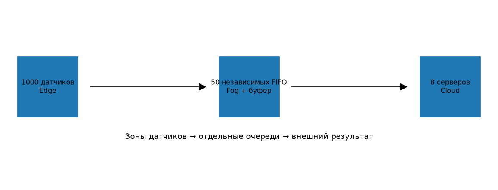

# Модель простыми словами

Датчик сообщает о событии на парковке. Он сначала тратит время на обработку,
затем сообщение занимает канал своей зоны. В Fog оно либо сразу обслуживается,
либо ждёт в очереди, либо теряется при заполненном буфере. После Fog сообщение
проходит следующий канал и обрабатывается свободным облачным сервером.

В модели не одна общая очередь: у каждого из50Fog своя очередь и свой буфер.
Каждая стадия имеет время начала и конца. Из этих записей получается задержка
и видно, где событие ждало. Сумма шести сохраняемых частей равна всему времени.
Все скорости обслуживания и события — синтетические. Названия оборудования
из тезисов не превращают эти числа в измерения реальных устройств.

Первая тетрадь меняет конфигурацию и показывает эффект. Вторая по прошлым
завершённым событиям прогнозирует задержку; маленькая нейросеть — только пример
подключаемой модели. Третья превращает прогнозы в порядок предпочтения устройств
и выбирает допустимое размещение целых подграфов. Прогноз не отменяет проверку
памяти, связей, каналов и срока.

При редком потоке очередь может быть пустой: увеличение буфера ничего не даст.
При перегрузке большой буфер уменьшает потери, но принятые события могут ждать
дольше. Поэтому одного среднего времени недостаточно. Сравниваются и потери,
и задержки, а неудобные результаты не удаляются.
